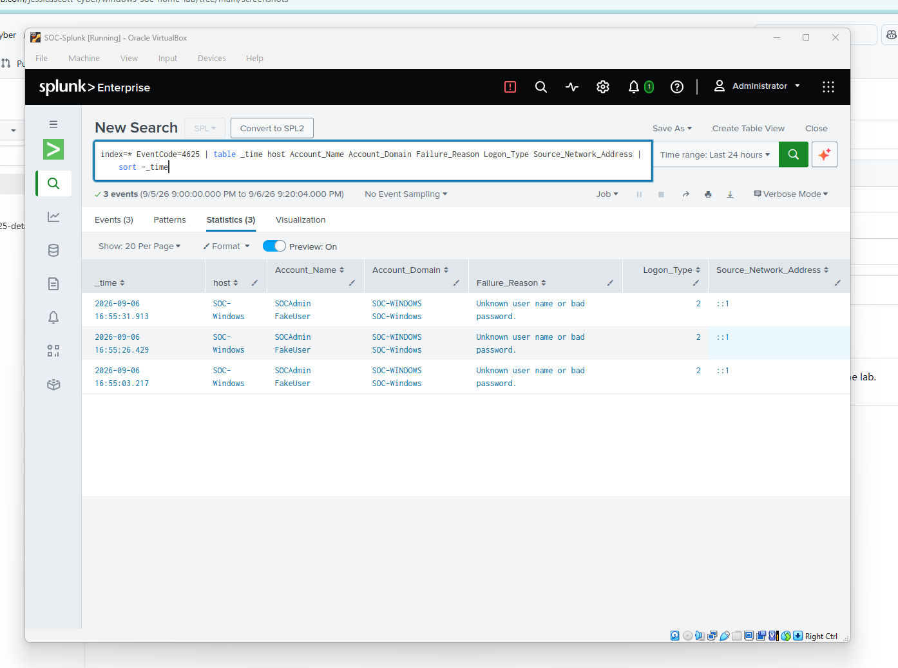
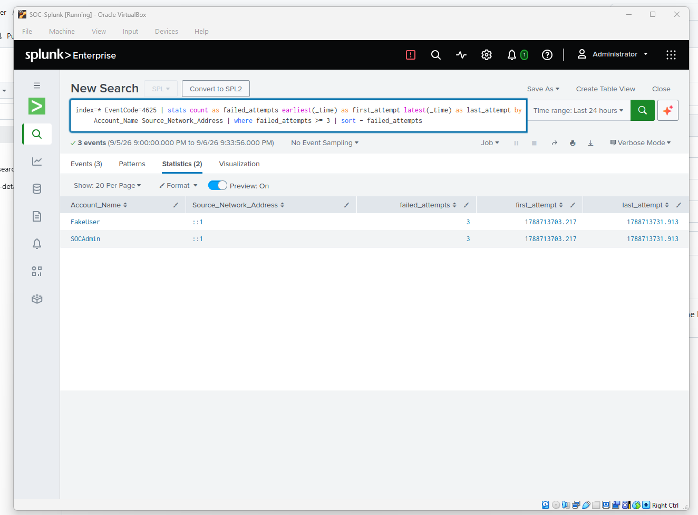
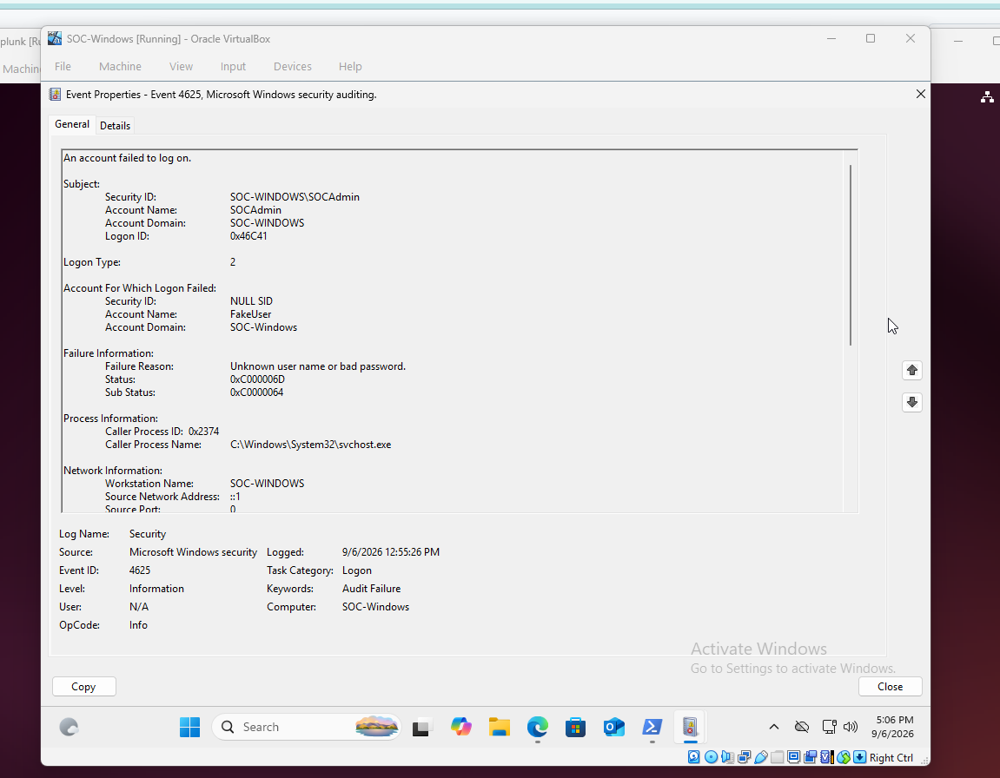

# Windows SOC Home Lab — Splunk SIEM

## Project Overview

This project is a hands-on cybersecurity home lab designed to practice Security Operations Center (SOC) monitoring and investigation techniques.

The lab uses a Windows workstation and Splunk Enterprise to collect and analyze Windows Security Event Logs. The primary investigation looks at a short burst of failed logon events and works out whether it is suspicious.

All activity in this lab is simulated in an isolated environment. It is not a real attack or a real incident.

## Lab Architecture

The lab was built using virtual machines in Oracle VirtualBox.

```text
SOC-Windows
Windows 11
     |
     | Windows Security Event Logs
     |
     v
Splunk Universal Forwarder
     |
     | Host-Only Network
     |
     v
SOC-Splunk
Ubuntu 24.04 LTS
Splunk Enterprise
     |
     v
Security Event Analysis
```

## Technologies Used

- Splunk Enterprise 10.4.2
- Splunk Universal Forwarder 10.4.2
- Ubuntu 24.04 LTS
- Windows 11
- Oracle VirtualBox
- Windows Security Event Logs
- SPL (Splunk Search Processing Language)

## Project Objectives

- Build a basic virtualized SOC environment
- Configure Windows Security Event Log collection
- Forward Windows security events to Splunk
- Verify that Windows events are successfully ingested
- Use SPL to search and filter security events
- Investigate failed authentication attempts
- Analyze security event details
- Document investigation findings and recommendations

## Investigation: Failed Windows Logons

### Investigation Overview

The investigation focused on Windows Security Event ID 4625, which records failed logon attempts.

The goal was to determine:

- Which accounts were involved
- How many failed attempts occurred
- When the attempts occurred
- Where the attempts originated
- Why the authentication attempts failed
- Whether the activity appeared suspicious

### Splunk Search — Failed Logons

The following SPL query was used to identify failed Windows logon events:

```spl
index=* EventCode=4625
| table _time host Account_Name Account_Domain Failure_Reason Logon_Type Source_Network_Address
| sort - _time
```



### Splunk Search — Repeated Failed Attempts

The following query was used to identify repeated authentication attempts, grouped by the targeted account:

```spl
index=* EventCode=4625
| eval target_account=mvindex(Account_Name,-1)
| stats count AS failed_attempts earliest(_time) AS first_attempt latest(_time) AS last_attempt BY target_account Source_Network_Address
| where failed_attempts >= 3
| sort - failed_attempts
```

Note: `Account_Name` holds two values per 4625 event (the requesting account, then the targeted account), so the target is the last value.

The screenshot below was taken with an earlier version of this query that grouped by `Account_Name` directly. Because every event has two account names, each event was counted under both names, so the 3 events appear as 3 attempts for each of two accounts. The corrected query above counts each event once.



## Findings

The search returned **3 failed logon events (Event ID 4625)** within about 30 seconds.

Each 4625 event records two account names: the account that made the request and the account that was targeted.

- **Account that made the request:** `SOCAdmin` (the local session I was signed in to)
- **Account that was targeted:** `FakeUser` (a made-up account I tried to log on as)

Other details from the events:

- **Logon type:** 2 (interactive)
- **Source address:** `::1` (the IPv6 loopback address, meaning this same machine)
- **Failure reason:** `Unknown user name or bad password.`

Reviewing the expanded event details confirmed that the attempt against `FakeUser` was made from the `SOCAdmin` session.



## Analysis

Three failed logons in about 30 seconds can look like password guessing at first glance.

Reviewing the full event details changed that picture:

- The source address `::1` is the loopback address, so the attempts came from the local machine and not from the network.
- The targeted account, `FakeUser`, does not exist, and the failure reason matches that.
- The attempts were made from my own `SOCAdmin` session.
- I created this activity on purpose as part of a controlled lab exercise.

Based on this evidence, I classified it as benign test activity and not a security incident.

This exercise showed why I should review the full event, including the source address and both account names, before treating a burst of failed logons as an attack.

## Recommended Actions

If this had been a real alert, the next steps would be:

- Verify whether the authentication attempts were expected.
- Review the targeted account and the authentication source.
- Continue monitoring for additional failed logon events.
- Investigate further if the number of attempts increases.
- Investigate further if attempts begin originating from an external address.
- Correlate the activity with other security events, such as a successful logon (Event ID 4624) afterward.

## Evidence

Screenshots from the investigation are in the `screenshots` folder:

1. Splunk failed logon search results
2. Splunk repeated failed attempts search (earlier query version, see the note above)
3. Expanded Windows Security Event 4625 details

## Skills Demonstrated

- SIEM monitoring
- Splunk Enterprise
- SPL query development
- Windows Security Event Log analysis
- Event ID 4625 investigation
- Authentication investigation
- Security event triage
- Evidence analysis
- Incident assessment
- Security documentation

## Results

- Collected Windows Security Event Logs from a Windows 11 virtual machine into Splunk Enterprise.
- Used SPL to find failed logon events (Event ID 4625) and to group them by targeted account.
- Read the full 4625 event details to separate the requesting account from the targeted account, and corrected an early over-count caused by the two account names in each event.

The investigation demonstrated this SOC workflow:

**Detect → Investigate → Analyze → Assess → Recommend**

## Limitations

- All activity was simulated on one endpoint in an isolated lab.
- The detection is a manual search, not a scheduled alert.

## Future Improvements

- Create additional Splunk security detections
- Build a basic SOC dashboard
- Add alerting for repeated authentication failures (requires a Splunk license that supports alerting)
- Investigate additional Windows Security Event IDs
- Expand the lab with additional simulated security events
